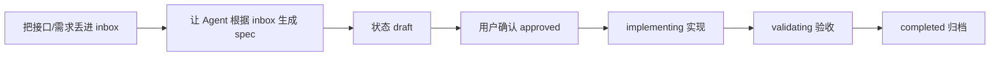

# ingot-admin 变更规格

本目录存放前端能力规格与进行中的变更，与工程文档（`docs/`）、AI 编码规范（`.agents/skills/`）互补。

面向公司实际协作：后端（或同一人）产出接口文档 → 丢进 `inbox/` → Agent 生成 change（`draft`）→ 确认后施工。不套用标准 SDD / OpenSpec / Spec Kit。

Agent 施工门禁见根目录 [AGENTS.md](../AGENTS.md)。

## 目录结构

```text
specs/
├── README.md                 # 本文件：工作流与约定
├── CONSTITUTION.md           # 项目不可协商原则
├── inbox/                    # 投递区：人丢接口/需求，Agent 消费后清空
├── current/                  # 已上线的页面行为规格
│   └── <domain>/
│       └── <capability>/
│           ├── README.md
│           └── spec.md
├── changes/
│   ├── active/               # 进行中的变更（Agent 生成，人不用手建）
│   │   └── <change-id>/
│   └── archive/              # 已完成变更（按年归档）
│       └── <year>/
│           └── <change-id>/
└── templates/
    ├── current/
    └── change/
```

## 与其他文档的关系

| 路径 | 用途 |
|------|------|
| `AGENTS.md` | Agent 施工门禁 |
| `docs/` | 工程/运维指南（构建、CI、TS 配置） |
| `specs/` | 前端变更规格与接口投递 |
| `.agents/skills/` | AI 编码规范与提交规范（实现层约束） |
| `apps/admin/src/pages/platform/*/README.md` | 源码目录导航（可链接到 `current/`） |

接口真相在后端仓库；本仓库的 `API.md` 是本次前端对接用的副本，不维护独立契约库。

## 域（domain）命名

与现有业务域对齐，使用小写 kebab-case：

| domain | 说明 |
|--------|------|
| `base` | 平台配置（应用、菜单、权限、角色、字典等） |
| `security` | 安全中心 |
| `admin` | 后台管理 |
| `member` | 会员管理 |
| `develop` | 开发工具 |
| `aam` | AAM 模块 |
| `common` | 跨域公共能力 |
| `org` | 组织架构 |
| `ingot-login` | 登录应用 |
| `packages` | 共享包（utils、hooks 等） |

`capability` 为域下的具体能力，如 `role-management`、`access-protection`。

## 给人：日常怎么用

1. 把后端接口文档（以及可选的需求文档）放到 [`inbox/`](./inbox/README.md)
2. 对 Agent 说：根据 inbox 生成本次变更 spec（可补充页面放哪、范围）
3. 审 Agent 产出的 `changes/active/<change-id>/`；确认后让 Agent 开工（状态 `approved` → `implementing`）
4. 验收通过后归档（见下方）

不要自己建 `change-id` 目录，也不用先复制模板。同一句话里「生成并实现」时，Agent 仍会先停在 `draft` 等你确认。

### 两种协作模式

- **前后端分离**：后端交付接口文档 → 丢进 inbox（需求可一起丢）→ Agent 生成 change → 确认后实现
- **一人全栈**：把自写的或从后端仓拷来的接口/需求丢进 inbox，其余相同

只在对话里贴了后端文件路径、没有拷到 inbox 时，Agent 应把该文件拷进即将创建的 change。

## 给 Agent：根据 inbox 生成 change

详细投递规则见 [`inbox/README.md`](./inbox/README.md)。摘要：

1. 读取指定 inbox（默认根目录；有子目录则按用户指定，或仅当只有一个子目录时自动选）
2. 生成 `change-id = <今天日期>-<domain>-<feature>`；`changes/active/` 已存在同 id 则加后缀，禁止覆盖
3. 从 [`templates/change/`](./templates/change/) 创建 `changes/active/<change-id>/`
4. **移动** inbox 中的接口/需求文件，规范为 `API.md` / `REQUIREMENTS.md`；在 README 记录原始文件名与后端来源，**状态设为 `draft`**
5. 根据输入生成 `README.md`、`DESIGN.md`、`TASKS.md`（接口字段表不要抄进 DESIGN）
6. 确认 inbox 对应位置已空
7. 停在 `draft`，不改业务代码。用户确认后将状态改为 `approved`，开工时改为 `implementing`
8. 实现阶段只读该 change 目录，不再读 inbox

inbox 里已有完整后端接口文档时，以移入的原文为准，不必按 `templates/change/API.md` 重写。

施工门禁见 [AGENTS.md](../AGENTS.md)。实现前阅读 [CONSTITUTION.md](./CONSTITUTION.md) 与 [in-coding-standards](../.agents/skills/in-coding-standards/SKILL.md)。优先读本 change 的 `API.md` 与 `REQUIREMENTS.md`。

## 状态机

状态写在 change 的 `README.md` 顶部（`> 状态：draft`）。

```text
draft → approved → implementing → validating → completed
                                         ↘ cancelled
```

| 状态 | 含义 | 可否改业务代码 |
|------|------|----------------|
| `draft` | spec 刚生成或仍在改 | 否 |
| `approved` | 用户已确认需求和设计 | 可以开始，开工即改为 `implementing` |
| `implementing` | 正在写代码 | 是 |
| `validating` | 实现完成，待验收 | 只改测试/修验收问题 |
| `completed` | 已更新 current，待归档或已归档 | 否（归档） |
| `cancelled` | 取消，记录原因后归档 | 否 |

偏离已批准的 `DESIGN.md` / `API.md` / `REQUIREMENTS.md` 时，先更新 spec 并经用户确认，再继续改代码。实施期间不提前修改 `current/`。

## 变更 ID

```text
<YYYYMMDD>-<domain>-<feature>
```

示例：`20260820-security-session-safety`

由 **Agent 命名**，人不用管。日期为创建日；domain 用上表；feature 为短英文描述。

## 变更目录结构

```text
changes/active/<change-id>/
├── README.md           # 做什么、范围、协作模式、输入来源
├── API.md              # 接口契约（从 inbox 移入）
├── REQUIREMENTS.md     # 页面/交互需求（可选：inbox 未提供则 Agent 根据接口整理）
├── DESIGN.md           # 前端方案：页面拆分、路由、models/api 映射
├── TASKS.md            # 实现清单
└── phases/             # 可选：大功能才拆
```

### 文档职责

| 文件 | 写什么 | 不写什么 |
|------|--------|----------|
| `README.md` | 状态、动机、范围、协作模式、输入来源、完成记录 | 接口字段表 |
| `API.md` | 路径、方法、权限码、请求/响应、枚举、错误码、鉴权与 `R<T>` | 页面布局、组件拆分 |
| `REQUIREMENTS.md` | 用户场景、页面/Tab/操作、验收标准 | 逐字段复制接口 |
| `DESIGN.md` | 页面四件套路径、路由、`api/` / `models/` 映射 | 再贴一份接口表（引用 `./API.md`） |
| `TASKS.md` | 可勾选实现项 | — |
| `phases/` | 复杂变更按阶段拆任务 | — |

### 哪些必填

- **README.md、TASKS.md**：始终要有
- **API.md**：前后端分离、或本次对接后端接口时要有
- **REQUIREMENTS.md**：有产品/交互要求时要有；inbox 没给时，Agent 可根据接口和对话补一版场景与验收
- **DESIGN.md**：页面结构不是「照接口做一张 CRUD 表」时要有；简单页可写得很短，但须写清页面路径与 API 映射

## 工作流



## 归档流程

变更完成并合并代码后（状态 `validating` → 验收通过）：

1. **更新 current**：把本次**页面行为**（场景、入口、主要操作）写入 `current/<domain>/<capability>/spec.md`。**不要**把整份 `API.md` 合并进 current
2. **链接接口副本**：在 `current/<domain>/<capability>/README.md` 记变更 ID，并链到 `changes/archive/<year>/<change-id>/API.md`
3. **移动目录**：状态改为 `completed`，将整个变更目录移至 `changes/archive/<year>/<change-id>/`

取消的变更标记 `cancelled`，记录取消原因后同样归档，不得直接删除。

若 `current/` 中尚无对应 capability，先从 `templates/current/` 复制创建。

## 新建能力规格

```bash
# 示例：为 security 域下的 session-safety 创建规格
mkdir -p specs/current/security/session-safety
cp specs/templates/current/README.md specs/current/security/session-safety/
cp specs/templates/current/spec.md specs/current/security/session-safety/
```

## 原则

实现前请阅读 [AGENTS.md](../AGENTS.md) 与 [CONSTITUTION.md](./CONSTITUTION.md)。先有输入（inbox 或已生成的 change），状态 `approved` 之后再改业务代码。

- [框架统一时间契约与 UTC 处理](./changes/archive/2026/20261008-packages-time-contract/README.md)（completed，2026-10-13 用户确认验证完成并归档）；[当前能力](./current/packages/time-contract/README.md)

- [公共字段访问控制](./changes/archive/2026/20261010-common-field-access-control/README.md)（completed，2026-10-10 人工验收完成并归档）；[当前能力](./current/common/field-access-control/README.md)

- [框架标签统一](./changes/archive/2026/20261010-packages-unified-tags/README.md)（completed，2026-10-13 用户确认验证完成并归档）；[当前能力](./current/packages/admin-ui-foundation/README.md)

- [角色版本信息与批量应用](./changes/archive/2026/20261010-base-role-version-application/README.md)（completed，2026-10-11 人工验收完成并归档）；[当前能力](./current/base/role-version-application/README.md)

- [角色详情加载优化](./changes/archive/2026/20261012-base-role-detail-loading/README.md)（completed，2026-10-12 人工验收通过）；[当前能力](./current/base/role-version-application/README.md)


## 近期归档

- [已移出成员重新加入](./changes/archive/2026/20261020-org-tenant-member-rejoin/README.md)（completed，2026-10-20）；[当前能力](./current/org/members-departments/README.md)

- [部门负责人独立维护](./changes/archive/2026/20261019-org-department-leaders/README.md)（completed，2026-10-20 用户确认验收完成）；[成员与部门](./current/org/members-departments/README.md)、[组织成员选择](./current/packages/tenant-member-picker/README.md)

- [租户添加成员对话框](./changes/archive/2026/20261018-org-tenant-member-create-dialog/README.md)（completed，2026-10-19 用户要求归档）；[当前能力](./current/org/members-departments/README.md)

- [成员与部门拆为两个子页面](./changes/archive/2026/20261017-org-members-dept-tabs/README.md)（completed，2026-10-17 用户要求归档）；[当前能力](./current/org/members-departments/README.md)

- [顶栏多应用导航交互与分类面板](./changes/archive/2026/20261013-packages-application-navigation/README.md)（completed，2026-10-13 用户验收通过并归档）；[当前能力](./current/packages/app-header/README.md)

- [登录失败保护维度选择交互](./changes/archive/2026/20261012-security-login-failure-dimension-selection/README.md)（completed，2026-10-13 用户确认验证完成并归档）；[当前能力](./current/security/access-protection/README.md)

- [整页配置表单正文布局](./changes/archive/2026/20261012-common-centered-form-layout/README.md)（completed，2026-10-13 用户确认验证完成并归档）；[当前能力](./current/common/admin-ui-experience/README.md)

- [平台能力补齐与页面归属整理](./changes/archive/2026/20261012-iam-platform-capability-completion/README.md)（completed，2026-10-13 用户确认验证完成并归档）；[当前能力](./current/base/platform-capabilities/README.md)

- [访问防护列表与行操作整理](./changes/archive/2026/20261012-security-access-table-refinement/README.md)（completed，2026-10-13 用户确认验证完成并归档）；[当前能力](./current/security/access-protection/README.md)

- [安全中心页面交互与布局](./changes/archive/2026/20261012-security-page-interactions/README.md)（completed，2026-10-13 用户确认验证完成并归档）；[当前能力](./current/security/credential-policies/README.md)

## 当前活动变更

- [组织角色即时授权与拥有者交互](./changes/active/20261014-org-tenant-live-authorization/README.md)（validating；2026-10-14 开发与隔离验证完成，待用户产品验收，2026-10-19已登记本地提交）
- [基础 IAM 管理台](./changes/active/20260913-base-iam-admin/README.md)：按用户要求保留 active，继续独立维护。
