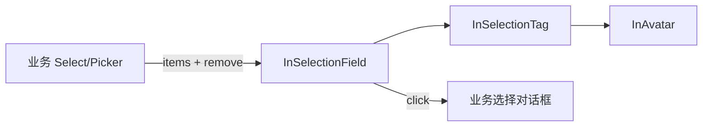

# Design

## 分层

`admin-core` 只提供展示与交互壳；业务组件负责打开对话框与维护选中值。

## 主题变量

| 变量 | 浅色 | 深色 |
| --- | --- | --- |
| `--in-selection-tag-bg` | `#e1eaff` | 主色 24% 混透明 |
| `--in-selection-tag-height` | `var(--in-tag-height)` | 同 |
| `--in-selection-tag-avatar-size` | `20px` | 同 |
| `--in-selection-tag-radius` | `var(--in-tag-radius)` | 同 |

## InSelectionTag

- Props：`name`、`avatar`、`showAvatar=true`、`closable=false`、`disabled`、`background`、`avatarSize`、`closeLabel`。
- Emits：`close`。
- 插槽：`avatar`、`default`（名字）、`suffix`。
- 有头像：`border-radius: calc(height / 2)`；无头像：`--in-selection-tag-radius`。
- 删除与 suffix 区阻止冒泡。

## InSelectionField

- Props：`items: InSelectionItem[]`（`{ id, name, avatar?, closable? }`）、`closable`、`showAvatar`、`total`、`maxVisible`、`wrap=true`、`placeholder`、`icon='ep:edit' | false`、`disabled`、`tagBackground`、`size`。
- Emits：`click`、`remove(item)`。
- 插槽：`tag`、`tag-avatar`、`tag-name`、`tag-suffix`（作用域 `{ item }`）、`empty`、`icon`、`prefix`。
- 外框 `role="button"`、`tabindex`，Enter/Space 触发 `click`。
- `+N` 由 `selectionOverflow.ts`（自 admin-common `memberChipOverflow` 下沉）计算。

## 迁移

| 组件 | 方式 |
| --- | --- |
| `BizIamMemberChips` | 内部改用 `InSelectionTag`，props 保持；主负责人、不可用提示放 suffix |
| `BizTenantMemberSelect` | 外壳改为 `InSelectionField`，带头像，最多 5 个 + `+N`；`showPrimary` 时主负责人置顶并带「部门主负责人」suffix。`#selection` 插槽移除（唯一调用方已迁移） |
| `BizIamGroupWizard` 成员字段 | `InSelectionField`；默认部门回退列表的 el-tag 改 `InSelectionTag` |
| `MemberDepartmentField` / `GroupDepartmentField` | `InSelectionField`，`tag-avatar` 固定为 20px 主题色部门圆标，`tag-extra` 改 `tag-suffix`；移除 `markVariant`/`markSize` |
| `DepartmentLeaderField` | 去掉 `#selection` 覆写 |
| `BizIamAuthorizationRecipients` | `InSelectionField`，成员带头像、用户组不带 |
| `BizIamOptionTagField` | `InSelectionField`，无头像 |
| `BizIamChipPageSelect` | 已选 el-tag 改 `InSelectionTag` |
| `BizIamDelegationCandidatePicker` | 文本按钮改 `InSelectionField`；成员类候选带头像，其余不带；未回显名称的部分计入 `+N` |
| `BizIamDelegationRolePicker`、`BizIamAuthorizationRolePicker`、平台 `MemberRolesField`、平台 `EntitlementDraftPanel` 自选应用 | 文本按钮 / el-input 改 `InSelectionField`，无头像 |

`BizIamDelegationActionCeilings` 是「已配置 N / M 项」的配置入口而非已选回显，保持原样。

## 演示

dev-portal `demos` 接入 UnoCSS（处理 `@apply`），并以静态图标替代依赖 iconify 虚拟模块的 `InIcon`。
